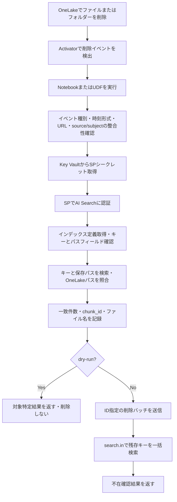

# OneLakeの削除イベントとAzure AI Searchのドキュメント削除を連携する

Microsoft FabricのOneLakeでファイル／フォルダーを削除した際に、対応するAzure AI Searchの検索ドキュメントを特定・削除するサンプルです。Fabric Notebookとユーザーデータ関数（以下UDF）の2通りを用意しています。**どちらか一方を選んで実行**します。

PDFをチャンク分割して取り込んだ場合は、1ファイルに対応する複数の`chunk_id`をまとめて特定します。OneLakeのファイル自体を、このコードから削除することはありません。

> **既定はdry-runです。** 対象ID・ファイル名・件数を確認してから実削除を有効にしてください。検索インデックス全体の走査上限と、1回の削除件数上限があります。大規模フォルダーの自動一括削除を保証する実装ではありません。

## 配布物とコードの読み方

| 用途 | GitHubでコードを読む | Fabricで使用する |
|---|---|---|
| Activatorから削除イベントを受信 | [イベント連携用Python版](./notebooks/AI_Search_OneLakeイベント連携.py) | [イベント連携Notebook](./notebooks/AI_Search_OneLakeイベント連携.ipynb) |
| UDF | [function_app.py](./udf/function_app.py) | ファイル全体をUDFエディターに貼り付け |
| 外部ライブラリ | [requirements.txt](./requirements.txt) | Fabric Environment／UDFのLibrary managementへ登録 |

Gitで配布するイベント連携Notebookは**実行用の`.ipynb`と閲覧用の`.py`を併記**しています。Python版には`# %%`でコードセル、`# %% [markdown]`で説明セルを区切っているため、GitHubのNotebookプレビューに依存せず読めます。

- Python版は隣のNotebookから生成した閲覧用コピーです。`%pip`等のIPythonコマンドはコメント化しています。
- Fabricへのインポートには`.ipynb`を使用してください。Python版だけでは、パラメーターセル等のNotebookメタデータは復元できません。
- 手動のID特定・指定ID削除を試す`AI_Search_OneLake検証.ipynb`と、その閲覧用`.py`はGit配布対象外です。ローカル検証用として保持し、Gitには追加しないでください。
- 各NotebookとUDFは共通処理を内包しており、別のPythonモジュールをFabricへアップロードする必要はありません。
- このリポジトリには、インデックス等のリソース作成コード、検証PDF、記事原稿は含めていません。既存インデックスへの取り込みが完了した環境で使用します。
- 公開ファイルの接続情報はプレースホルダーです。実行結果やシークレット値は含めていません。

## 処理の流れ



イベント処理では、対象特定結果を削除前状態として使います。削除前にIDごとの再取得は行いません。手動の指定ID削除では、削除前の個別GETを行います。

## 事前準備

### AI Searchのインデックス

- ファイルの内容が既に取り込まれていること。
- キーフィールド（例：`chunk_id`）がretrievableであること。実削除後の一括確認には、さらに**filterable、normalizerなし**が必要です。
- 元ファイルのOneLake URLを保持する、retrievableなトップレベルの`Edm.String`フィールドがあること。既定は`metadata_storage_path`です。
- チャンク分割した場合、そのパスが**各チャンク**に保持されていること。

通常の対象特定では検索結果のURLを正規化して照合します。`metadata_storage_path`にURLエンコードされたBlob URLが保存されていても、OneLakeイベントのBlob URLと照合できます。比較用の内部表現はDFS URLです。

対応ホストは`onelake.blob.fabric.microsoft.com`と`onelake.dfs.fabric.microsoft.com`です。リージョン別／ワークスペース別エンドポイントには対応していません。ワークスペース名とGUID等の別名変換はしないため、保存パスと入力の表記を揃えてください。

### 認証と権限

| 接続 | 認証主体 | 必要な準備 |
|---|---|---|
| Notebook → Key Vault | Notebook実行主体 | 対象シークレットの読取権限、ネットワーク到達性 |
| UDF → Key Vault | UDFアイテム所有者 | 対象シークレットの読取権限、ネットワーク到達性 |
| Notebook／UDF → AI Search | サービスプリンシパル（SP） | `Search Service Contributor`と`Search Index Data Contributor` |

AI Search側はMicrosoft Entra IDによるデータプレーン認証を有効にします。`Search Service Contributor`はインデックス定義の取得に、`Search Index Data Contributor`は検索・ドキュメント削除に使用します。APIキーは使用しません。

SPのクライアントシークレットはKey Vaultに保存してください。コードに設定するのは**Vault URIとシークレット名**であり、シークレット値そのものではありません。

ライブラリは[requirements.txt](./requirements.txt)を参照してください。UDFでは、Fabric提供のSDKで`generic_connection`と`FabricItem`が使用できることも必要です。コードはPython 3.11の構文を対象にしています。

## 共通設定

Notebookの設定セル、または[function_app.py](./udf/function_app.py)先頭を編集します。各配布物の設定は独立しており、自動同期されません。

| 設定名 | 既定値・入力例 | 説明 |
|---|---|---|
| `SEARCH_ENDPOINT` | `https://YOUR-SERVICE.search.windows.net` | AI Searchサービスのエンドポイント |
| `INDEX_NAME` | `idx-onelake-udf` | 実際に取り込み済みのインデックス名。Notebookでも任意の名前に変更可能 |
| `TENANT_ID` | `YOUR-TENANT-ID` | SPのテナントID |
| `CLIENT_ID` | `YOUR-CLIENT-ID` | SPのアプリケーション（クライアント）ID |
| `KEY_VAULT_URL` | `https://YOUR-VAULT.vault.azure.net` | Vault URI。`/secrets/...`は付けない |
| `SECRET_NAME` | `ai-search-client-secret` | SPシークレットを保存したKey Vaultのシークレット名 |

AI SearchのAPIバージョンは共通処理の`SearchProbe`で`2025-09-01`を使用します。

## Notebookを使用する

### 手動でIDを特定・削除する（ローカル検証用）

手動検証用NotebookはGitHubから配布していません。必要な場合は、ローカルに保持している`AI_Search_OneLake検証.ipynb`を使用してください。Fabricへのインポート前に共通設定を確認し、既定の`DRY_RUN = True`で削除対象を確認してください。実削除を行う場合は、対象IDと確認文字列を設定してから実行します。

### Activator連携Notebook

1. [イベント連携Notebook](./notebooks/AI_Search_OneLakeイベント連携.ipynb)をFabricへインポートします。
2. [requirements.txt](./requirements.txt)のライブラリをFabric Environmentに登録し、Notebookにアタッチします。イベントごとの`%pip`実行はしません。
3. 最初のコードセル（6つのイベント変数）をFabricの**パラメーターセル**に指定・確認します。
4. 共通設定と後述の`EVENT_*`設定を編集し、保存します。
5. ActivatorのNotebookアクションで、後述の6引数を動的プロパティへ割り当てます。
6. `EVENT_ENABLE_DELETE = False`で対象を確認した後、実削除を有効にします。

結果はJSONとして表示し、`notebookutils.notebook.exit()`でも返します。

## UDFを使用する

1. Fabricでユーザーデータ関数アイテムを作成します。
2. Library managementに[requirements.txt](./requirements.txt)のライブラリを登録します。
3. [function_app.py](./udf/function_app.py)の**全文**をエディターに貼り付け、共通設定と`EVENT_*`を編集します。
4. Testで`inspect_search_index`、`find_search_documents`、イベント関数のdry-runを確認します。
5. Publishし、Activatorで公開済みの`handle_onelake_deleted_event`を選択します。コード修正後もPublishが必要です。

### keyVaultClientの扱い

各公開関数には次の宣言があります。

```python
@udf.generic_connection(argName="keyVaultClient", audienceType="KeyVault")
@udf.function()
def inspect_search_index(keyVaultClient: fn.FabricItem) -> dict:
    ...
```

`fn.FabricItem`はFabric SDKに用意された型、`keyVaultClient`は注入先の引数名です。デコレーターの指定に基づき、**Fabricが実行時にオブジェクトを渡します**。利用者はこの引数へ値を入力せず、インスタンスも作成しません。型注釈だけでは自動注入されません。

`argName`はPythonの引数名と一致させ、`audienceType`は`"KeyVault"`のまま使用します。Vault名やURLを入れる項目ではありません。この方式では通常の接続aliasをManage connectionsで作成する必要はありません。

`keyVaultClient.get_access_token()`が返す資格情報オブジェクトを`SecretClient`に渡し、`get_secret(SECRET_NAME).value`でシークレットを取得します。認証主体はUDF所有者です。シークレット値やトークンを入力・ログ出力しないでください。

### 公開関数と引数

全関数共通の注入引数`keyVaultClient`は、以下のユーザー入力には含めません。

#### inspect_search_index

入力なし。インデックスのキーと文字列フィールドの定義を返します。個々のドキュメントのID・保存パス値を取得するAPIではありません。

#### find_search_documents

| 引数 | 型 | 説明 |
|---|---|---|
| `source` | str | `Files/...`、HTTPS Blob／DFS URL、ABFSS URL |
| `scope` | str | `file`または`directory` |
| `pathField` | str | パスフィールド名 |
| `workspace` | str | 相対パス使用時のワークスペースID。完全URLなら空文字列でよい |
| `lakehouse` | str | 相対パス使用時のLakehouse ID。完全URLなら空文字列でよい |
| `maxScan` | int | 走査行数上限。1～10,000 |
| `exactFilter` | bool | 通常はfalse。Notebookの`EXACT_FILTER`と同じ仕様 |

```json
{
  "source": "Files/Documents/sample.pdf",
  "scope": "file",
  "pathField": "metadata_storage_path",
  "workspace": "YOUR-WORKSPACE-ID",
  "lakehouse": "YOUR-LAKEHOUSE-ID",
  "maxScan": 1000,
  "exactFilter": false
}
```

フォルダーの場合は`source`を`Files/Documents`、`scope`を`directory`にします。戻り値の`document_ids`、`documents`、`matched_count`を確認します。

#### delete_search_documents

| 引数 | 型 | 説明 |
|---|---|---|
| `documentIds` | list | 削除対象の実キー。非空文字列のリスト。重複除去後1～100件 |
| `dryRun` | bool | trueで削除前確認のみ |
| `confirmation` | str | 実削除時に`DELETE <index名> <重複除去後のID数>`。dry-runでは空文字列可 |

```json
{
  "documentIds": ["actual-chunk-key-1", "actual-chunk-key-2"],
  "dryRun": true,
  "confirmation": ""
}
```

実削除する場合は`dryRun`をfalse、`confirmation`をたとえば`DELETE idx-onelake-udf 2`へ変更します。`EVENT_ENABLE_DELETE`はこの手動関数には適用されません。

#### handle_onelake_deleted_event

入力は次の6つの文字列です。Notebookと同じ名前・仕様で、dry-runか実削除かはコード側の`EVENT_ENABLE_DELETE`で決めます。

## Activatorのイベント引数

OneLakeイベントの取り込み対象を設定し、`FileDeleted`または`FolderDeleted`からNotebook／UDFを実行するルールを構成します。

| 引数 | 型 | Activatorの動的プロパティ例 | 目的 |
|---|---|---|---|
| `eventId` | str | `___id` | ログと結果を関連付けるイベントID |
| `eventType` | str | `___type` | `Microsoft.Fabric.OneLake.FileDeleted`または`Microsoft.Fabric.OneLake.FolderDeleted` |
| `eventTime` | str | `System.IngestionTime` | ISO 8601の取り込み時刻。形式確認と結果への記録に使用 |
| `eventSource` | str | `___source` | ワークスペース／アイテムの整合性確認 |
| `eventSubject` | str | `___subject` | `/Files/...`形式の削除対象パス |
| `blobUrl` | str | `blobUrl` | 対象の完全なOneLake Blob URL。DFS URLも受け付ける |

列名はイベントの取り込み結果に合わせて確認してください。値欄には固定文字列`@Id`等を入力せず、**動的プロパティ**を選択します。`eventTime`には、アクション画面で選択できる`System.IngestionTime`を使用します。元イベントの`time`ではありません。

- 6引数はすべて必須。前後の空白を除去しますが、文字列内部の空白は変更しません。
- タイムゾーン付き時刻はそのオフセットを保持します。タイムゾーンなしはUTCとして扱います。鮮度チェックには使用しません。
- `eventSource`は`/tenants/<tenant>/workspaces/<workspace>/items/<lakehouse>`形式と、旧形式`/<tenant>/workspaces/<workspace>/items/<lakehouse>`を受け付けます。
- URLとsourceのワークスペース／Lakehouse、URLとsubjectのパスを照合します。不一致なら削除しません。
- `FileDeleted`は単一ファイル完全一致、`FolderDeleted`はフォルダー境界を区別して配下全体に照合します。
- 呼び出し時に`keyVaultClient`や認証設定、`EVENT_*`をイベント引数として渡しません。

## イベント処理の設定

| 設定 | 既定値 | 仕様 |
|---|---|---|
| `EVENT_PATH_FIELD` | `"metadata_storage_path"` | 元ファイルのパスを保持するフィールド |
| `EVENT_ENABLE_DELETE` | `False` | Falseは対象特定と削除前状態の報告のみ。Trueで削除・不在確認を実行 |
| `EVENT_MAX_SCAN` | `1000` | 1～10,000の整数。インデックスの検索で走査する行数の上限。ヒット件数ではない |
| `EVENT_MAX_DELETE` | `20` | 1～100の整数。1イベントで一致した一意のチャンクID数上限。dry-runにも適用 |

bool設定に文字列`"false"`、整数設定にbool等は使用できません。上限超過時は例外で停止し、部分的に取得したIDだけを削除することはありません。

対象フォルダーの範囲はActivatorの取り込み設定で管理します。コード側に対象prefix制限、イベント鮮度制限、UTC補完の切り替えフラグはありません。Notebook／UDFを直接呼び出す利用者の実行権限も制限してください。

**100件はPDF数ではなくチャンク数です。** 1つのPDFだけで100チャンクを超えることもあり、フォルダーは配下の合計です。上限を超える規模では、このサンプルの上限設定を変更するだけでなく、対象特定・分割処理・再試行設計を見直してください。

## 実行結果と監視

イベント処理の`outcome`は次のいずれかです。

| 値 | 意味 |
|---|---|
| `dry_run` | 対象が見つかり、削除せず終了 |
| `deleted` | 削除APIの項目別結果を確認し、対象キーの不在を検索で確認 |
| `no_matches` | 一致するキーが0件。マッピング誤りや再実行等を確認 |

`lookup`の`matched_count`はファイル数ではなく一意のチャンク数です。`documents`には`id`、`chunk_id`、`file_name`、`source_path`、`document_ids`にはキー一覧を返します。`scanned`は走査行数、`complete`は走査完了を示します。

削除結果には`existing_before`、`absent_before`、`before_check`を返します。イベント処理の`before_check`は`lookup_result`、手動指定ID削除は`individual_get`です。実削除時は`remaining_ids`、`verified_absent`等も返します。

UDFの監視ハブの「呼び出しの詳細」では、Informationログを確認します。

- `AI_SEARCH_LOOKUP_SUMMARY`：ヒット総数、走査件数、完了状態、index、event_id。
- `AI_SEARCH_LOOKUP_DOCUMENT`：ヒットしたチャンクごとにchunk_idとファイル名。
- `AI_SEARCH_KEY_VAULT_SECRET_READY`：UDFでのシークレット取得成功。値は記録しません。

一致ログは削除成功の証拠ではありません。最終状態と削除後確認結果まで確認してください。ファイル名やIDがログに残るため、ログのアクセス範囲に注意してください。Fabric側のログ表示・保存制限で省略される場合、画面だけで全件確認済みと判断しないでください。

Key Vaultの最初のGETで401、Authorization付き再送で200となる場合は、SDKの認証チャレンジによる正常動作の場合があります。最終的な失敗は例外として伝播します。中間401だけを理由に認証検証を無効化しないでください。

## リクエスト数と制約

対象特定は、既定では**インデックス全体を走査してクライアント側でパスを照合**します。フォルダーによるサーバー側絞り込みは行いません。削除対象が少数でも全体が走査上限を超えると失敗します。

対象特定の検索要求数をP、手動指定ID数をCとしたAI Searchへの要求数の目安：

| 操作 | AI Searchへの要求 |
|---|---|
| イベントdry-run | 定義GET 1回＋対象特定の検索P回 |
| イベント実削除 | 上記＋削除POST 1回＋残存キーの一括検索1～4回（各回1ページの場合） |
| 手動指定IDのdry-run | 定義GET 1回＋削除前の個別GET C回 |
| 手動指定IDの実削除 | 上記＋削除POST 1回＋残存キーの一括検索1～4回（各回1ページの場合） |

削除後の確認は`search.in`でまとめて行い、残っていたキーのみ次回検索します。継続ページがあれば全ページ取得するため要求数は増えます。上記にはKey VaultとEntra ID認証の通信を含めていません。

- Search操作の独自時間予算は70秒です。ネットワークやスロットリングにより、上限内の件数でも完了を保証しません。
- 1回の削除は最大100キー、ペイロードは15 MiB以下です。AI Searchサービス自体の上限とは別です。
- 削除後は最大4回、間隔2秒で検索します。時間切れや一部失敗は**削除されていないという意味ではありません**。再試行前に状態を確認してください。
- 同時更新のスナップショット一貫性、永続的な重複排除、exactly-once、同一パスに再作成されたファイルの世代保護はありません。
- 古い削除イベントを、同じパスへ再作成・再取り込みした後に実削除で再生しないでください。
- インデクサーが対象チャンクを再作成する可能性があります。元ファイルとインデクサーの状態も確認してください。
- このサンプルは検証用です。大量ファイル、同時イベント、本番の再試行・監視・権限制御は別途設計してください。

## Notebookを編集した場合

`.ipynb`を編集し、実行結果を消去してから、リポジトリルートで次を実行してください。追加のPythonパッケージは不要です。

```shell
python scripts/export_notebooks.py
python scripts/export_notebooks.py --check
```

[変換スクリプト](./scripts/export_notebooks.py)は説明とコードのセル順を保持して閲覧用Python版を生成します。`--check`は生成物の一致を確認します。Notebookに実行結果が残っている場合はエラーにし、誤って公開することを防ぎます。

Notebook内の共通処理とUDF内の共通処理はコピーです。ロジックを修正する場合は両経路の整合性を確認し、各環境でdry-runから検証してください。

## API・公式リファレンス

- [Fabric UDFのPythonプログラミングモデル／Key Vault generic connection](https://learn.microsoft.com/en-us/fabric/data-engineering/user-data-functions/python-programming-model#connect-to-azure-key-vault-using-a-generic-connection)
- [NotebookからKey Vaultを使用する](https://learn.microsoft.com/en-us/fabric/data-engineering/notebook-utilities#credentials-utilities)
- [Fabric UDFの呼び出しログ](https://learn.microsoft.com/en-us/fabric/data-engineering/user-data-functions/view-function-logs)
- [Azure AI Search：インデックス定義取得](https://learn.microsoft.com/en-us/rest/api/searchservice/indexes/get?view=rest-searchservice-2025-09-01)
- [Azure AI Search：検索](https://learn.microsoft.com/en-us/rest/api/searchservice/documents/search-post?view=rest-searchservice-2025-09-01)
- [Azure AI Search：ID指定取得](https://learn.microsoft.com/en-us/rest/api/searchservice/documents/get?view=rest-searchservice-2025-09-01)
- [Azure AI Search：アップロード／更新／削除](https://learn.microsoft.com/en-us/rest/api/searchservice/documents/index?view=rest-searchservice-2025-09-01)
- [search.in関数](https://learn.microsoft.com/en-us/azure/search/search-query-odata-search-in-function)
- [Key Vaultの認証チャレンジ](https://learn.microsoft.com/en-us/azure/key-vault/general/authentication-requests-and-responses#authentication-requirements)
